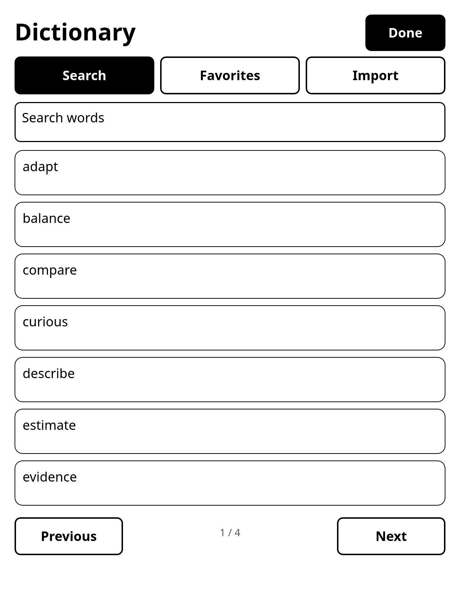
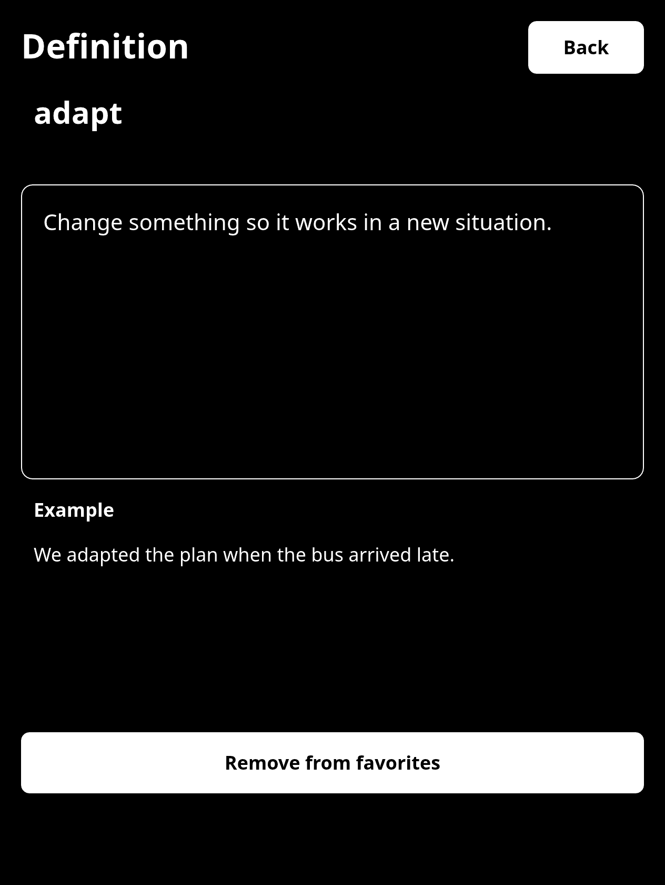
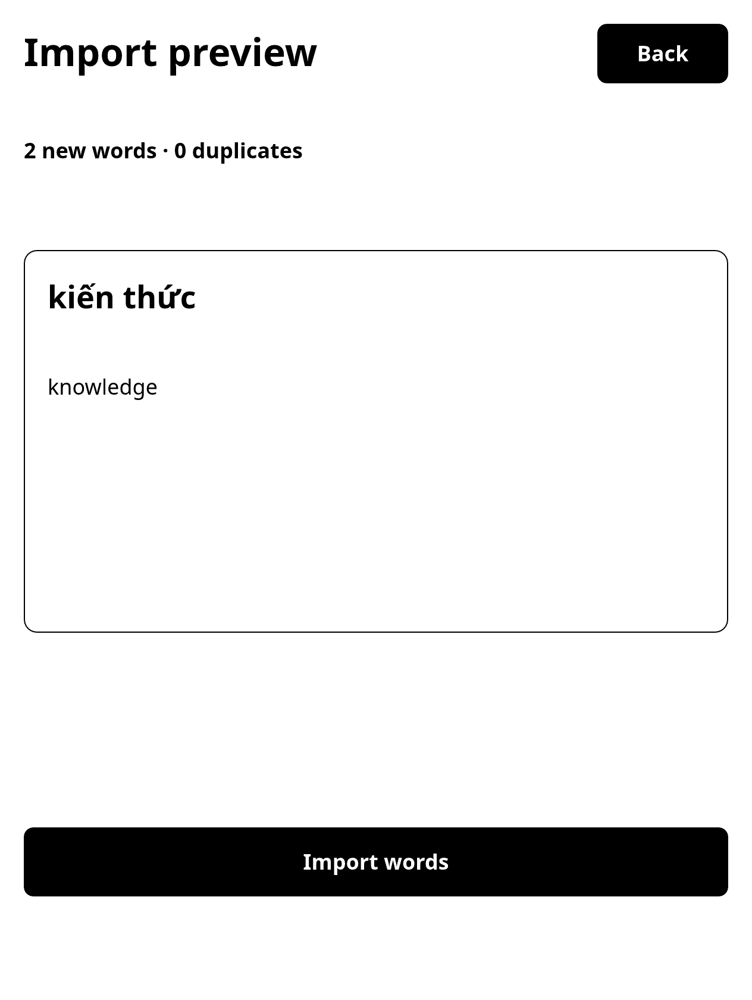

# Dictionary

**Look up words offline**

  

[**Download**](https://github.com/PrimitiveOS/kindle-primitive-dictionary/releases/latest) · [**Install guide**](INSTALL.md) · [**Changelog**](CHANGELOG.md)

---

Look up words, read definitions and examples, and save useful terms. Import your own UTF-8 dictionary from a tab-separated file and export favorites for Cards.

## Quick start

After setting up PrimitiveOS, open **Store** from Primitive Launcher. Choose **Dictionary** under **Apps**,
tap **Get**, and open it from the Launcher grid. The [install guide](INSTALL.md) also covers the standalone USB package.

## Screenshots

| Search and browse | A saved definition | Import preview |
|---|---|---|
|  |  |  |

Screenshots are from the desktop simulator.

## Highlights

- Look up words, read definitions and examples, and save useful terms.
- Import your own UTF-8 dictionary from a tab-separated file and export favorites for Cards.

## Status

| Device | Status |
|---|---|
| Kindle Oasis 3 (1264 × 1680, firmware 5.18.2) | Tested on hardware |

**Current version: 0.1.2.** Changes are in [CHANGELOG.md](CHANGELOG.md).

## Downloads

The badge at the top shows the number of Store downloads. It counts GitHub downloads of this app's release packages, across all versions and architectures, and is refreshed daily from the [Store catalog](https://primitiveos.github.io/kindle-primitive-catalog/v1/index.json).

## Documentation

[Install guide](INSTALL.md) · [Changelog](CHANGELOG.md)

## Licence

Code uses [PolyForm Noncommercial 1.0.0](LICENSE). Project-owned documentation, screenshots, artwork, and the starter glossary use [CC BY-NC-SA 4.0](LICENSE-DOCS).
